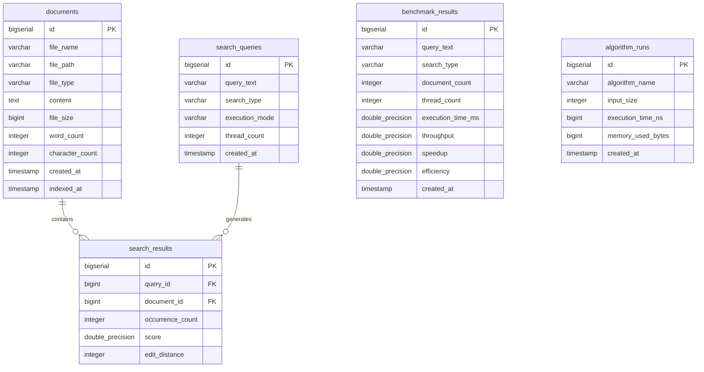

# PostgreSQL Database Architecture (`texthack_db`)

## 1. Database Connection Properties
- **Host:** `localhost`
- **Port:** `5432`
- **Database:** `texthack_db`
- **Default Username:** `postgres`
- **Configured Password:** `1234`
- **Driver:** `org.postgresql.Driver`
- **Pool:** HikariCP (Max 10, Min idle 2)

---

## 2. Table Schemas & Relationships

---

## 3. Index Strategy
- `idx_documents_file_name` on `documents(file_name)`: Fast lookup when syncing disk documents.
- `idx_documents_file_type` on `documents(file_type)`: Format-based filtering.
- `idx_results_query_id` on `search_results(query_id)`: Instant retrieval of ranked query matches.
- `idx_benchmarks_thread_count` on `benchmark_results(thread_count)`: Fast historical trend analytics.
